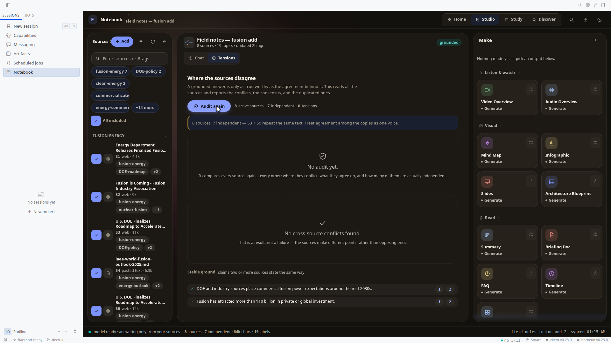
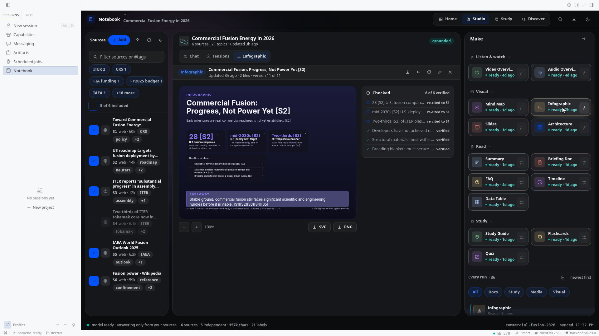
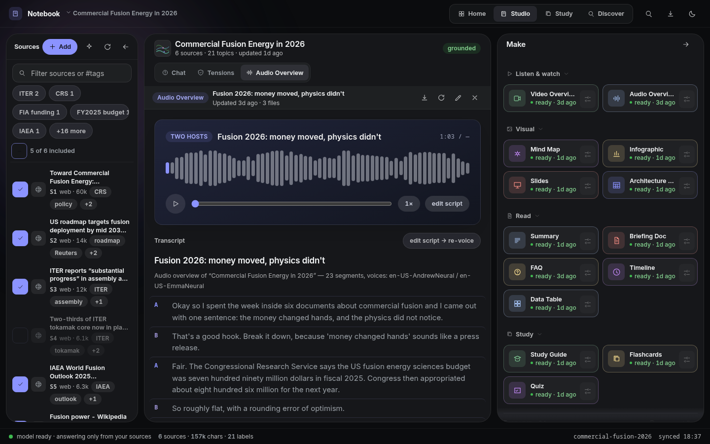
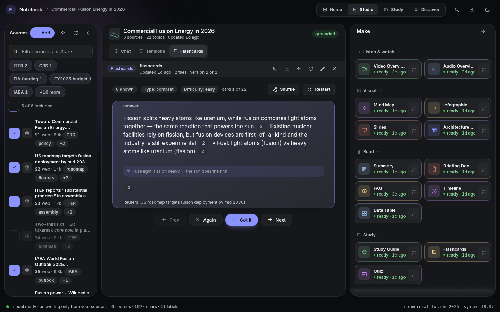

# Hermes Notebook


A research studio inside Hermes Desktop. You give it sources. Everything it
answers, writes or draws comes only from those sources — and shows you where it
came from.

Built for the 2026 Hermes Plugin Competition. MIT.

## See it







Every image is a real screenshot of this plugin. No mockups.

## What it does

**Add sources.** Files, PDFs, Office docs, EPUB, images, audio and video
recordings, web pages, YouTube, pasted text — or find them on the web without
leaving the page. Every source gets labelled and summarised on arrival; a
duplicate is detected by content hash, not added twice.

**Ask, in as many conversations as you like.** Answers come only from the
sources. Every claim carries a numbered citation — hover shows the passage it
was built from, click opens the source itself. Many named threads per
notebook, each with its own memory: "pricing" and "history" don't pollute each
other. Citation numbers are stable — `S3` means the same source everywhere in
the notebook.

**See where they disagree.** Tensions reads all your sources and reports the
conflicts — each side quoted and cited — plus how independent they really are:
three syndicated copies of one story show up as three sources and one
confirmation, not three. `8 sources · 7 independent` is a measured fact about
your evidence, not a vibe.

**Make things.** Two-host audio overviews (deep dive, brief, critique,
debate), narrated video overviews, mind maps, flashcards, quizzes, real
`.pptx` slide decks, `.xlsx`/`.csv` data tables, briefing docs, timelines —
and infographics that **check every figure they print against the source it
cites**. A number that isn't in its cited source is left out, never typeset
anyway; the Checked panel lists what was verified, re-cited and dropped.

**Study what you made.** Flashcards and quizzes aren't dead documents — the
notebook schedules your next review (SM-2 spaced repetition) and the schedule
survives regeneration.

**Work it from anywhere.** The Desktop studio, `/notebook` in chat,
`hermes notebook …` on the command line, 19 tools for the agent itself, a
bundled skill. Same store underneath — the page and the chat can never
disagree.

## What it costs

Every answer shows its own receipt — `5 sources · 9.8k chars · 4.2s`, and real
token counts when the model reports them. Chat keeps the last three exchanges
verbatim and folds older ones into a rolling summary made by the cheap
auxiliary model, so follow-ups don't re-send the whole notebook. Generation
reuses a cached source digest until a source changes. `notebook_ask` is
capped at 16k characters of context by default.

## When AI runs — and when it doesn't

Nothing runs until you ask. Sources, questions and generations go to the model
Hermes is already using — your model, whichever it is. The plugin was verified
end-to-end on a small local model and a mid-size hosted one; cheap work
(labels, summaries, suggestions) routes to the smaller `auxiliary.notebook`
slot when one is configured. The model never typesets graphics: it fills
structured JSON, deterministic code draws the charts — the same quality on any
model, or a clear error, never a silent wrong figure.

Find-on-the-web needs the host's `web_search` (or an EXA/TAVILY key). Audio
and video need `ffmpeg` on PATH and network access for edge-tts. Scanned PDFs
need OCR first; YouTube needs public captions.

## Privacy

```
Your Hermes Desktop → local notebook store (~/.hermes/plugin-data/hermes-notebook)
                    → your Hermes model        (only when you ask)
                    → the web, via Hermes web tools (only URLs/searches you trigger)
```

No telemetry, no accounts, no analytics. Data leaves your machine only to your
model provider and to pages you explicitly fetch.

## vs NotebookLM

| | NotebookLM | Hermes Notebook |
|---|---|---|
| Grounded answers + citations | inline chips | same, plus each chip carries the passage it was built from — hover shows it |
| Where sources disagree | — | **Tensions**: quoted conflicts + measured independence ("8 sources, 7 independent") |
| Infographics | image-model art, numbers baked in | **every figure verified against its cited source**; unsupported claims dropped and listed |
| Audio | 4 formats | same 4 formats + transcript + seekable waveform |
| Video | cinematic overviews | narrated mp4, cinematic/explainer |
| Study | flashcards, quiz | + **spaced-repetition scheduling** (SM-2) |
| Slides / tables | pptx / sheets | `.pptx`, `.xlsx`/`.csv` exports |
| Reports | pdf/docx | — (planned) |
| Where it runs | Google's app + models | **any Hermes surface, any model**, data on your machine |
| What it costs you | plan limits | **per-answer receipt** + aux-model history compaction |

## Recordings as sources

Meetings, interviews, lectures and recorded demos are material people already
have:

- ffmpeg decodes to 16 kHz mono mp3 in 10-minute segments (only the ffmpeg
  binary needed), and Groq `whisper-large-v3-turbo` transcribes each segment.
- Key lookup, in order: `GROQ_API_KEY` env → `groq_api_key` plugin setting →
  the `GROQ_API_KEY` line of `$HERMES_HOME/.env`.
- The transcript *is* the source body — labelled, chunked, searchable and
  citable like any other source.
- Failures are sentences, never silence: no ffmpeg, no key, an HTTP body, or a
  recording with no audible speech each say which one happened.

## Honest limits

- Retrieval is BM25 over chunks — right for tens of sources, not a vector
  index over hundreds.
- Audio ~1–3 min, video ~3–6 min per generation, per-segment TTS + ffmpeg.
- Very large notebooks use head+tail digests for generation
  (`podcast_context_chars`, default 42k).
- Ask and Generate need the agent half enabled in the same profile — the page
  says so plainly (503) instead of pretending.

## Install

```bash
hermes plugins install DECRUX9812/hermes-plugin-notebook
# or from a local checkout:
hermes plugins install /path/to/hermes-plugin-notebook
hermes plugins enable hermes-notebook   # the backend routes need this
hermes gateway restart                  # plugin_api routes are imported once, at startup
```

Then reload the desktop window (Ctrl/Cmd-R) and open **Notebook** in the
sidebar, or ⌘K → *Notebook: open the studio*.

Python deps are declared in `plugin.yaml` (`pypdf`, `edge-tts`,
`youtube-transcript-api`, `trafilatura`, `openpyxl`, `pillow`) — installed by
the plugin manager. Audio/video overviews additionally need `ffmpeg` on PATH.

## Quickstart

```
/notebook new Q3 Earnings Analysis
/notebook add q3-earnings-analysis ~/Downloads/earnings.pdf
/notebook add q3-earnings-analysis https://example.com/analyst-note
/notebook ask q3-earnings-analysis what drove the margin expansion?
```

Or just ask in chat: *"create a notebook called X and add these files, then
make a study guide and a podcast about it"* — the bundled `notebook` skill
teaches the agent the workflow.

CLI equivalents: `hermes notebook list|new|add|ask|generate|audio|video|suggest|search|note|update|rm-source|export|discover|delete`.

## Tools

- `notebook_list` — notebooks, or sources inside one (`include_text` for full text)
- `notebook_create` — new notebook
- `notebook_add_source` — one source per call (`path` | `url` | `text`, plus optional `title`); skips exact duplicates
- `notebook_ask` — grounded Q&A with citations; optional `source_ids` scope and `thread=` follow-up history; returns a `usage` receipt
- `notebook_search` — ranked snippet search across the notebook
- `notebook_note` — save a user note as a searchable source
- `notebook_refresh` — re-fetch a url/file source in place (re-labels + re-summarizes)
- `notebook_delete_source` — remove one source and its stored text
- `notebook_generate` — artifacts to `<notebook>/artifacts/`; `format=csv` for Anki-importable flashcards, `thread=<name>` to brief the artifact from a conversation, `language` to write it in another language
- `notebook_audio` — mp3 + transcript + script JSON (4 formats, lengths, languages)
- `notebook_video` — mp4 + transcript + script JSON; `style=cinematic|explainer`
- `notebook_suggest` — next-step recommendations; optional `kinds` filter
- `notebook_update` — rename a notebook / change its description
- `notebook_export` — zip the notebook (sources, index, artifacts, chat) under `plugin-data/exports/`
- `notebook_discover` — candidate sources for a topic; `deep=true` runs extra research rounds
- `notebook_study` — spaced-repetition queue / review / stats over the notebook's own cards
- `notebook_tensions` — cross-source disagreement audit + independence clusters
- `notebook_threads` — list / new / rename / delete conversations (`delete` needs `confirm=true`)
- `notebook_delete` — destructive, requires `confirm=true`

## Backend routes

Mounted at `/api/plugins/hermes-notebook/` and reached from the page with
`ctx.rest` (the desktop grant rides along):

```
GET  /health                     liveness + data root + model readiness
GET  /state?notebook=&thread=    notebooks, sources, artifacts, thread, stats
POST /notebook                   { title, description }
POST /source                     { notebook, path|url|text, title? }
POST /ask                        { notebook, question, thread? } -> answer + citations + usage
POST /generate                   { notebook, kind, focus?, length? }
POST /label                      { notebook, force? }
POST /tensions                   { notebook, max_items?, language? } -> disagreement audit
GET  /artifact?notebook=&name=&b64=1
GET  /artifact/pptx?notebook=&name=&b64=1   -> the deck as .pptx
POST /discover                   { notebook, query?, deep?, rounds? } -> candidates
POST /search                     { notebook, query }
GET  /threads  ·  POST /thread/new|/thread/rename|/thread/delete
GET  /progress/<jid>  ·  POST /cancel/<jid>   long jobs report and honour stop
```

## Configuration

Under `plugins.entries.hermes-notebook.settings` (or `hermes plugins config`):

| key | default | meaning |
|---|---|---|
| `default_notebook` | `""` | notebook used when a call doesn't name one |
| `ask_context_chars` | `16000` | context budget per `notebook_ask` |
| `podcast_context_chars` | `42000` | context budget for scripts/artifacts |
| `podcast_length` | `medium` | default audio length (short ≈5m, medium ≈10m, long ≈18m) |
| `video_length` | `medium` | default video length (short ≈2m, medium ≈4m, long ≈7m) |
| `video_voice` / `video_voice_rate` | `en-US-AndrewNeural` / `-4%` | narrator voice + pace for videos |
| `audio_tts_concurrency` | `4` | parallel TTS segment workers |
| `audio_voice_host_a` / `audio_voice_host_b` | `en-US-AndrewNeural` / `en-US-EmmaNeural` | edge-tts voice names |
| `groq_api_key` | `""` | Whisper key for recording transcription; falls back to `GROQ_API_KEY` / `$HERMES_HOME/.env` |
| `discover_rounds` | `2` | research rounds a deep Discover pass may run (1–3) |

Cheap calls (source labeling, suggestions, history compaction) route through
the plugin's own `auxiliary.notebook` task slot — pin a model there if you
want them on a smaller/faster model.

## Storage

All state lives under `<hermes home>/plugin-data/hermes-notebook/notebooks/<id>/` —
per-profile, survives plugin updates:

```
notebook.json          metadata (title, description, updated_at)
threads/<name>.json    chat history per ask-thread (recent verbatim + rolling summary)
sources/index.json     source records (id, title, kind [incl. "note"], labels, summary, hash, locator)
sources/<id>.txt       extracted text
cache/                 source digests — reused until a source changes
artifacts/             generated .md / .html / .svg / .png / .csv / .json / .mp3 / .mp4 / .txt
tensions-cache.json    last audit + independence measurement
../exports/            notebook_export zips
```

## Design

[`docs/DESIGN-LORE.md`](docs/DESIGN-LORE.md) is the design story behind the UI —
the reading-room metaphor, the palette, and the five laws any interface change
must obey. Feed it to any model asked to design or generate surfaces here.
Eleven explicit state machines drive the view (`docs/STATE-MACHINES.md`).

## Development

```bash
python -m pytest tests/ -q          # agent half (no Hermes host needed)
node build.mjs                      # src/*.js -> desktop/plugin.js
python3 tests/dump_state.py         # real payloads for the preview harness
node tests/make-preview.mjs         # esbuild harness (SDK stubbed, React real)
node tests/gates.mjs                # bundle-load + functional + a11y + layout
node tests/design.test.mjs          # token scale + AA contrast, measured on the render
node tests/machine.test.mjs         # view/overlay state machines
node tests/parsers.test.mjs         # ingest parsers
node tests/timeline.test.mjs        # timeline artifact
node tests/shots-docs.mjs           # assets/shot-*.png + banner.png
python3 tests/serve_api.py 8917     # throwaway FastAPI mount to curl the routes
```

The demo seeders (`seed_demo.py`, `gen_artifacts.py`) need the Hermes package
on the path and edge-tts/Pillow installed.

Layout: `src/` — `00-head` (tokens, CSS, helpers), `10-ui` (icons, primitives,
dialog focus), `15-md` (markdown), `20-data` (ctx.rest + hooks), `30-shell`
(app bar, rail), `35-main` (chat, studio panel, status bar, dialogs),
`37-discover` (web candidate pickers), `38-tensions` + `38-study`,
`40-viewers` (video, audio, mind map, flashcards, quiz, slides, infographic,
timeline, doc views), `44-actions` (agent action cards),
`90-plugin` (registration, settings, directive). Agent half:
`hermes_notebook/` (`tools`, `agent`, `agent_tools`, `store`, `retrieve`,
`artifacts`, `audio`, `video`, `study`, `tensions`, `verify`, `gfx/`).

## License

MIT
