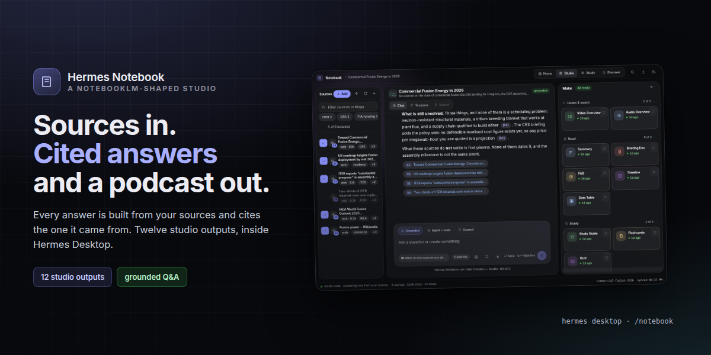
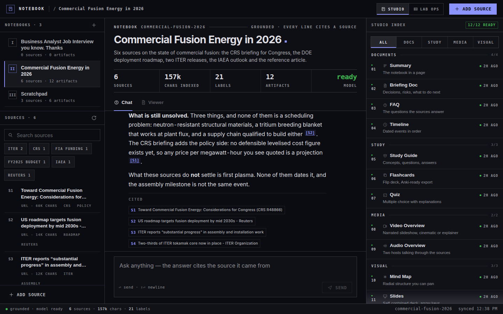
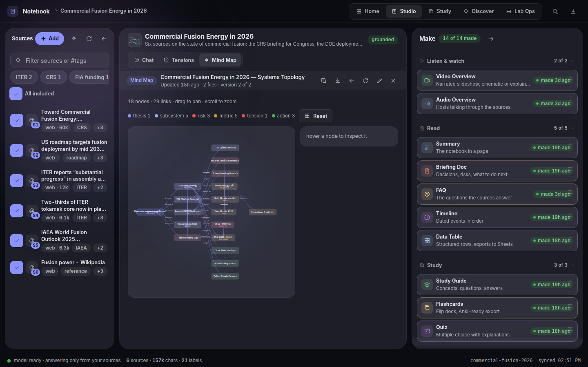
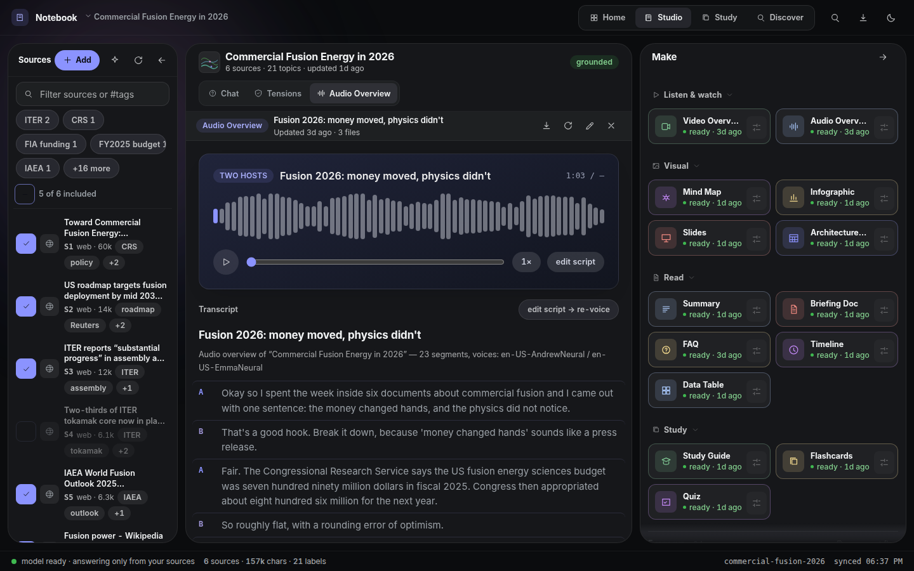
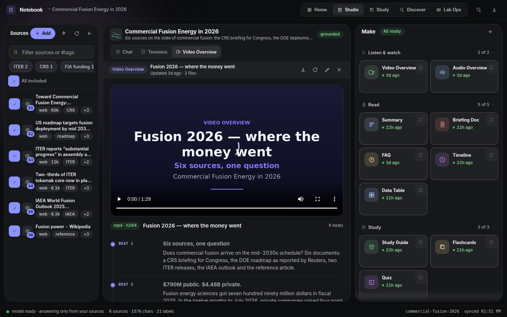
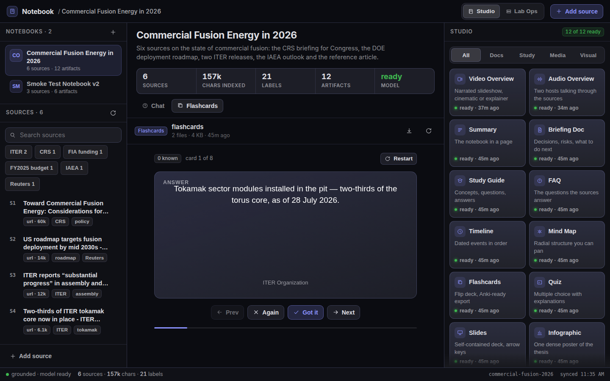
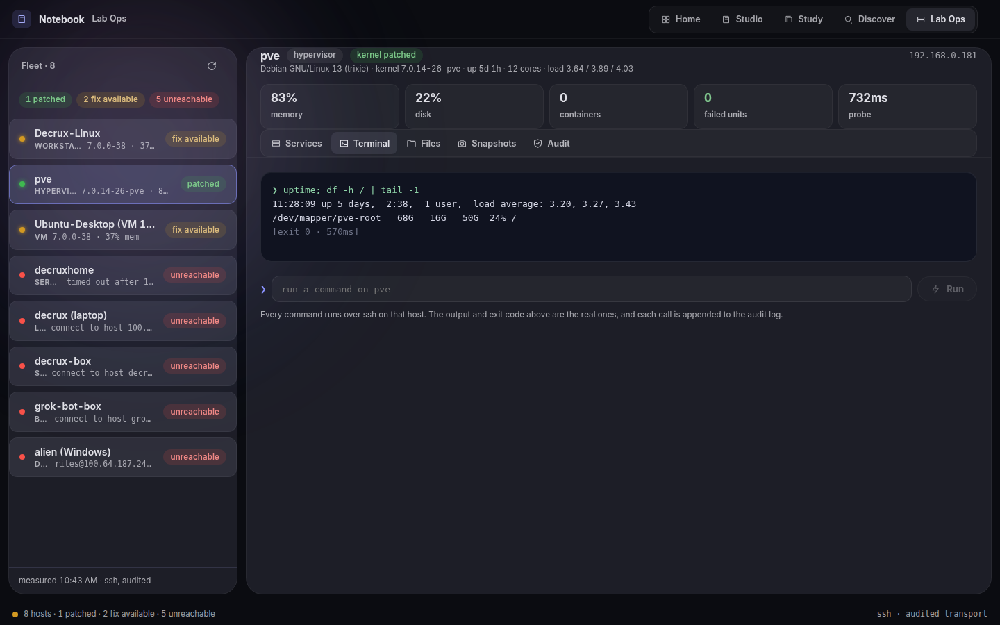
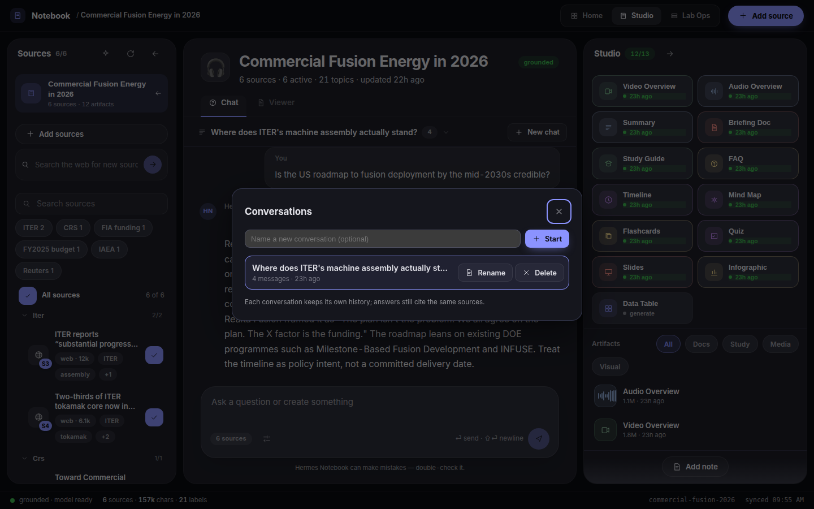

# Hermes Notebook



**NotebookLM, rebuilt as a real product surface inside Hermes Desktop** — plus a
lab deck in the same window. Sources go in; everything else is derived from them
and cites them by number.

Built for the 2026 Hermes Plugin Competition.

## See it in action








## The desktop studio

Three columns, one status bar, everything reachable by keyboard:

- **Sources rail** — notebooks on top, then this notebook's sources with the
  model's own topic labels and one-line summaries. Search and label chips
  narrow the list; every row carries its citation number (`S1`, `S2`, …).
- **Grounded chat** — answers only from the sources, with inline `[S1]`
  citations that open the source they point at. A question the sources do not
  cover gets a sentence saying so, not a confident guess.
- **Studio panel** — twelve outputs in four groups (Docs · Study · Media ·
  Visual): Video Overview, Audio Overview, Summary, Briefing Doc, Study Guide,
  FAQ, Timeline, Mind Map, Flashcards, Quiz, Slides, Infographic. Each card
  shows the state it is really in (`ready · 12m ago`, `writing · 8s`,
  `Generate`), and generation runs through the same `hermes_notebook.artifacts`
  code the agent tools use — so the page and the chat can never disagree.

The viewers are the product, not a file list: a pannable/zoomable SVG mind map,
a flip deck with `Again`/`Got it` grading that persists per card, a native slide
deck driven by arrow keys, a real `<video>`/`<audio>` player (bytes are fetched
through `ctx.rest` and handed to a blob URL, because a renderer cannot put the
desktop grant on a media element), an audio waveform that seeks, and a
transcript rendered from the generated text rather than raw markdown.

**Hermes-native by construction.** Every colour resolves through the app's theme
variables (`--ui-text-primary`, `--ui-accent`, `--ui-stroke-secondary`, …) so the
page follows light/dark and the user's accent. Contributions go through the
current SDK (`ctx.register({ id, area, data, render })`) with a two-line
detection shim so a host that only has the older `contribution()` still gets
every area. 16px body type, ≥32px hit targets, an accessible name on every
control, arrow-key tablists, a focus ring that resolves, and dialogs that trap
focus, close on Escape and return focus to their opener.

## Lab Ops (same plugin, second surface)

The `Studio | Lab Ops` switch at the top swaps the subject, not the design
system: eight hosts measured live over the audited ssh transport (kernel, load,
memory, disk, failed units, kernel patch posture), then a terminal, service
control, a file browser and Proxmox VM snapshots for the selected host.

- Every row is a real probe; a host that cannot be reached says why (`connect to
  host X port 22: timed out`) and offers no controls.
- The terminal posts one command line; the backend builds the ssh argv, refuses
  host-destroying commands without an explicit `confirm`, and returns the real
  stdout and exit code.
- Every action lands in an audit log the Audit tab renders.
- The inventory is `dashboard/hosts.json` — edit or delete it if the shipped
  fleet is not yours.

## What it does (agent half)

| NotebookLM feature | Hermes Notebook |
|---|---|
| Sources (files, PDFs, Office docs, web, YouTube) | `notebook_add_source` — path / URL / pasted text / images (vision-described) |
| Chat with sources + citations | `notebook_ask` — BM25 retrieval, `[S1]`-style citations, **many named conversations per notebook** (`thread=`), each with its own memory |
| Auto-labeling / source chips | Every source gets 2–5 topic labels + a one-line summary on ingest; duplicates detected by content hash |
| Source search | `notebook_search` — ranked full-text hits with snippets across all sources and notes |
| User notes | `notebook_note` — your annotations become first-class searchable sources |
| Source lifecycle | `notebook_refresh` re-fetches url/file sources, `notebook_delete_source` removes one |
| Suggestions | `notebook_suggest` — questions worth asking, artifacts worth making, source gaps (optional `kinds` filter) |
| Artifacts | `notebook_generate` — summary, briefing doc, study guide, FAQ, timeline, **mind map**, flashcards (md or Anki CSV), quiz, **slide deck** (self-contained HTML), **infographic** (SVG: 18 looks × 9 layouts), data table (CSV) |
| Audio Overview | `notebook_audio` — two-host conversational podcast (edge-tts voices + ffmpeg), with transcript |
| Video Overview | `notebook_video` — cinematic narrated mp4, `style=cinematic|explainer`, Pillow cards + ffmpeg |
| Web discovery | `notebook_discover` — web_search for candidate sources to add |
| Notebook management | `notebook_update` rename/describe, `notebook_export` whole notebook as zip |
| — desktop surface — | `/notebook` route, sidebar row, three palette commands, status-bar chip, `::notebook{name="…"}` transcript directive, settings page |
| — Hermes extras — | `/notebook` slash command, `hermes notebook` CLI, bundled skill, auxiliary task slot, per-notebook persistent storage |

## Conversations

A notebook holds **many chat threads**, not one. Each keeps its own memory and its
own title, so "pricing", "history" and "what changed in 2026" can be explored in
parallel without one line of enquiry dragging the history of another into the
answer. Every thread still cites the same sources.



| | |
|---|---|
| In the page | the chat bar shows the open conversation; the title opens a dialog to switch, rename, start (`New chat`) or delete one |
| New threads | titled automatically from their first question, or named up front |
| Agent tools | `notebook_threads` — `list`, `new`, `rename`, `delete` (delete needs `confirm=true`) |
| API | `GET /threads`, `POST /thread/new`, `POST /thread/rename`, `POST /thread/delete`, `GET /state?notebook=&thread=` |
| Storage | `threads/<name>.json` per notebook — title, created, updated, messages; older message-list files still load |
| Limits | 40 threads per notebook, 40 messages per thread (the oldest roll off) |

## Graphics library

Every visual artifact is drawn by a reusable library, not one-off code:
**18 looks × 9 templates × 3 shapes × 3 detail levels**, composed from primitives and
emitted as SVG (5–15 KB, crisp at any zoom, real text, accessible).


```python
from hermes_notebook import gfx

gfx.render(graphic, template="key_figure", preset="realistic",
           orientation="portrait", detail="detailed")
gfx.write_svg("cover.svg", graphic, template="cover", preset="cartoon")
gfx.to_png(graphic, "poster.png", preset="blueprint", scale=2)   # needs a browser
```

```python
notebook_generate(notebook="fusion-2026", kind="infographic",
                  style="blueprint", template="comparison",
                  orientation="landscape", detail="standard")
```

| | |
|---|---|
| Looks | 16 type-led presets (`sections`, `editorial`, `swiss`, `magazine`, `bento`, `blueprint`, `terminal`, `neon`, `brutalist`, `retro`, `risograph`, `kraft`, `chalkboard`, `dashboard`, `mission`, `poster`) + **`cartoon`** and **`realistic`** illustrated treatments |
| Layouts | `infographic`, `key_figure`, `stat_grid`, `timeline`, `comparison`, `process`, `quote_card`, `cover`, `illustration` |
| Knobs | shape (landscape / square / portrait), detail (concise / standard / detailed), theme overrides |
| Fidelity | exact text and numbers — the SVG carries the strings; no model re-typesets them |
| Fallbacks | alt text + `<title>`/`<desc>`, Pillow raster when no browser, unknown style/template degrades to the default |

Architecture, API, the NotebookLM comparison, edge-case table and test strategy:
[`docs/GRAPHICS-LIBRARY.md`](docs/GRAPHICS-LIBRARY.md).
Choosing a look: [`skills/notebook-infographics`](skills/notebook-infographics/SKILL.md).
Regenerate the sheets: `python3 tools/make_graphics_sheet.py --templates --examples`.

## Install## Install

```bash
hermes plugins install DECRUX9812/hermes-plugin-notebook
# or from a local checkout:
hermes plugins install /path/to/hermes-plugin-notebook
hermes plugins enable hermes-notebook   # the backend routes need this
hermes gateway restart                  # plugin_api routes are imported once, at startup
```

Then reload the desktop window (Ctrl/Cmd-R) and open **Notebook** in the sidebar,
or ⌘K → *Notebook: open the studio*.

Requires Python deps declared in `plugin.yaml` (`pypdf`, `edge-tts`,
`youtube-transcript-api`, `trafilatura`, `openpyxl`, `pillow`) — installed by the
plugin manager. Audio/video overviews additionally need `ffmpeg` on PATH.

If the agent half is not registered in the running gateway the page still renders
from `/api/plugins/hermes-notebook/state`, but Ask and Generate answer `503` with
that sentence instead of pretending to work.

## Demo flow (< 90 seconds)

1. **0:00** Open **Notebook** — the studio: sources left, `12 of 12 ready` right.
2. **0:08** Ask: *"Where does ITER assembly stand, and what is still unsolved?"*
3. **0:14** Answer lands with `[S3] [S4] [S2] [S1]` — click `[S2]`; the source it cites opens.
4. **0:26** Click **Mind Map** — pan, zoom, hover a branch for its detail.
5. **0:38** Click **Audio Overview** — play, scrub the waveform, read the transcript.
6. **0:52** Click **Flashcards** — flip a card, press *Got it*, watch `n known` move.
7. **1:02** Switch to **Lab Ops** — the fleet; pick `pve`, run `uptime; df -h / | tail -1`, show the exit code.
8. **1:18** Back to Studio, press **Generate** on a card you have not made yet and watch it turn `ready`.

## Quickstart (chat + CLI)

```
/notebook new Q3 Earnings Analysis
/notebook add q3-earnings-analysis ~/Downloads/earnings.pdf
/notebook add q3-earnings-analysis https://example.com/analyst-note
/notebook ask q3-earnings-analysis what drove the margin expansion?
```

Or just ask in chat: *"create a notebook called X and add these files, then make a study guide and a podcast about it"* — the bundled `notebook` skill teaches the agent the workflow.

CLI equivalents: `hermes notebook list|new|add|ask|generate|audio|video|suggest|search|note|update|rm-source|export|discover|delete`.

## Tools

- `notebook_list` — notebooks, or sources inside one (`include_text` for full text)
- `notebook_create` — new notebook
- `notebook_add_source` — one source per call (`path` | `url` | `text`, plus optional `title`); skips exact duplicates
- `notebook_ask` — grounded Q&A with citations; optional `source_ids` scope and `thread=` follow-up history
- `notebook_search` — ranked snippet search across the notebook
- `notebook_note` — save a user note as a searchable source
- `notebook_refresh` — re-fetch a url/file source in place (re-labels + re-summarizes)
- `notebook_delete_source` — remove one source and its stored text
- `notebook_generate` — artifacts to `<notebook>/artifacts/`; `format=csv` for Anki-importable flashcards
- `notebook_audio` — mp3 + transcript + script JSON
- `notebook_video` — mp4 + transcript + script JSON; `style=cinematic|explainer`
- `notebook_suggest` — next-step recommendations; optional `kinds` filter
- `notebook_update` — rename a notebook / change its description
- `notebook_export` — zip the notebook (sources, index, artifacts, chat) under `plugin-data/exports/`
- `notebook_discover` — web_search candidate sources for a topic (does not add them)
- `notebook_delete` — destructive, requires `confirm=true`

## Backend routes

Mounted at `/api/plugins/hermes-notebook/` and reached from the page with
`ctx.rest` (the desktop grant rides along):

```
GET  /health                     liveness + data root + model readiness
GET  /state?notebook=<id>        notebooks, sources, artifacts, thread, stats
POST /notebook                   { title, description }
POST /source                     { notebook, path|url|text, title? }
POST /ask                        { notebook, question, thread? } -> answer + citations
POST /generate                   { notebook, kind, focus?, length? }
POST /label                      { notebook, force? }
GET  /artifact?notebook=&name=&b64=1
POST /search
GET  /ops/fleet  /ops/services  /ops/files  /ops/file  /ops/snapshots  /ops/audit
POST /ops/exec   /ops/action    /ops/service  /ops/snapshot
```

## Configuration

Under `plugins.entries.hermes-notebook.settings` (or `hermes plugins config`):

| key | default | meaning |
|---|---|---|
| `default_notebook` | `""` | notebook used when a call doesn't name one |
| `ask_context_chars` | `28000` | context budget per `notebook_ask` |
| `podcast_context_chars` | `42000` | context budget for scripts/artifacts |
| `podcast_length` | `medium` | default audio length (short ≈5m, medium ≈10m, long ≈18m) |
| `video_length` | `medium` | default video length (short ≈2m, medium ≈4m, long ≈7m) |
| `video_voice` / `video_voice_rate` | `en-US-AndrewNeural` / `-4%` | narrator voice + pace for videos |
| `audio_tts_concurrency` | `4` | parallel TTS segment workers |
| `audio_voice_host_a` / `audio_voice_host_b` | `en-US-AndrewNeural` / `en-US-EmmaNeural` | edge-tts voice names |

Cheap calls (source labeling, suggestions) route through the plugin's own `auxiliary.notebook` task slot — pin a model there if you want labels on a smaller/faster model.

## Storage

All state lives under `<hermes home>/plugin-data/hermes-notebook/notebooks/<id>/` — per-profile, survives plugin updates:

```
notebook.json          metadata (title, description, updated_at)
threads/<name>.json    chat history per ask-thread
sources/index.json     source records (id, title, kind [incl. "note"], labels, summary, hash, locator)
sources/<id>.txt       extracted text
artifacts/             generated .md / .html / .png / .csv / .json / .mp3 / .mp4 / .txt
../exports/            notebook_export zips
```

## Design

[`docs/DESIGN-LORE.md`](docs/DESIGN-LORE.md) is the design story behind the UI —
the reading-room metaphor, the palette, and the five laws any interface change
must obey. Feed it to any model asked to design or generate surfaces here.

## Development

```bash
python -m pytest tests/ -q          # agent half (no Hermes host needed)
node build.mjs                      # src/*.js -> desktop/plugin.js + web/plugin.js
python3 tests/dump_state.py         # real payloads for the preview harness
node tests/make-preview.mjs         # esbuild harness (SDK stubbed, React real)
node tests/gates.mjs                # bundle-load + functional + a11y + layout
node tests/shots-docs.mjs           # assets/shot-*.png + banner.png
python3 tests/serve_api.py 8917     # throwaway FastAPI mount to curl the routes
```

The demo seeders (`seed_demo.py`, `gen_artifacts.py`) need the Hermes package on the
path and edge-tts/Pillow installed, or they fail with `No module named 'plugins'` and
`audio overviews need the edge-tts package`:

```bash
PYTHONPATH=<hermes-agent checkout> HERMES_HOME=~/.hermes \
  /path/to/venv/bin/python tests/seed_demo.py --notebook commercial-fusion-2026
```

`tests/gates.mjs` is the contract: the built bundle registers every area against
both SDK generations, a ready card opens its viewer, asking renders an answer
with citations, a citation opens its source, the label filter and search narrow
the rail, the deck lists the whole fleet, every control has a name and a ≥32px
target, body type is 16px, arrow keys move tablists, and nothing overflows at
1440/1280/1180/1024/820.

Layout: `src/` — `00-head` (tokens, CSS, helpers), `10-ui` (icons, primitives,
dialog focus), `15-md` (markdown), `20-data` (ctx.rest + hooks), `30-shell` (app
bar, rail), `35-main` (chat, studio panel, status bar, dialogs), `40-viewers`
(video, audio, mind map, flashcards, quiz, slides, infographic, timeline),
`50-ops` (lab deck), `90-plugin` (registration, settings, directive). Agent half:
`hermes_notebook/` — `runtime`, `store`, `extract`, `ingest`, `retrieve`,
`llmio`, `artifacts`, `audio`, `video`, `schemas`, `tools`.

## Honest limits

- The demo notebook under `tests/` is assembled from six real public sources; its
  model-written artifacts were authored by the agent because the CLI path to the
  configured provider had no credits at build time. `tests/gen_artifacts.py`
  regenerates them for real given a working model.
- Lab Ops drives machines over ssh. It is a control surface: read the action
  registry in `dashboard/ops_api.py` before pointing it at anything you care
  about — and note it refuses to reboot the machine serving the page.
- Retrieval is BM25 over chunks, not embeddings. Right for tens of sources; not a
  vector index.

## License

MIT
