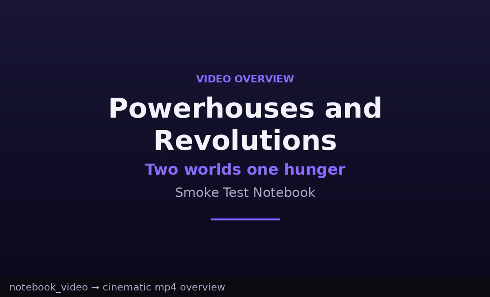
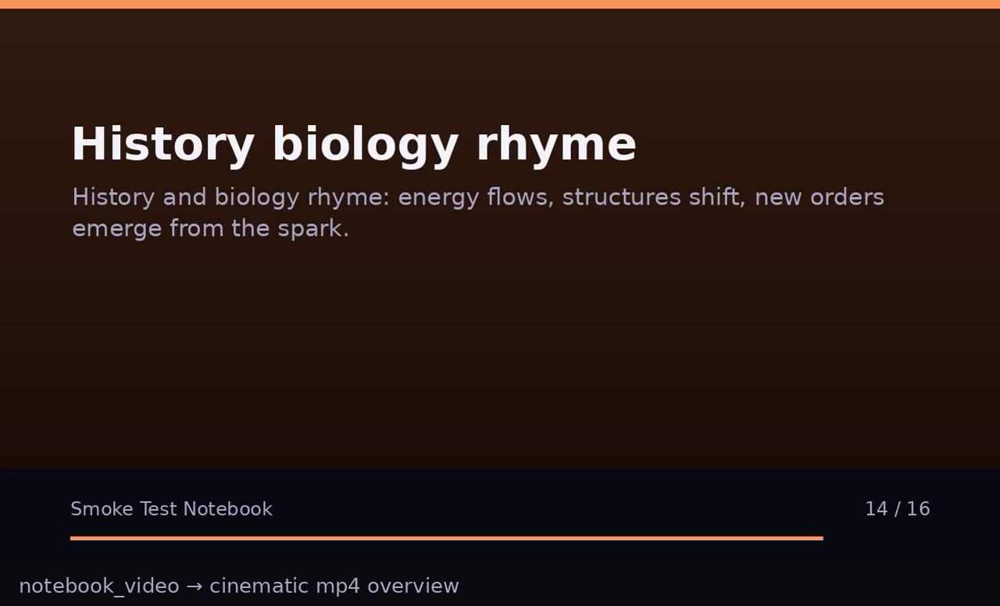
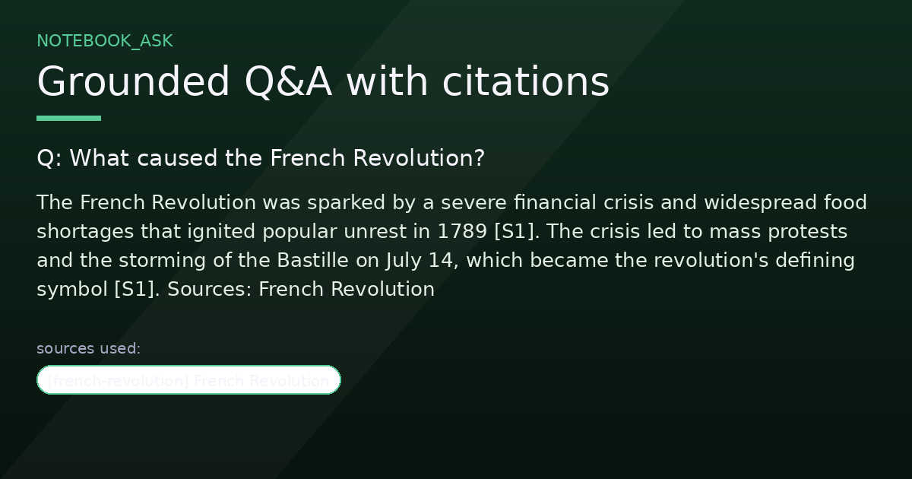
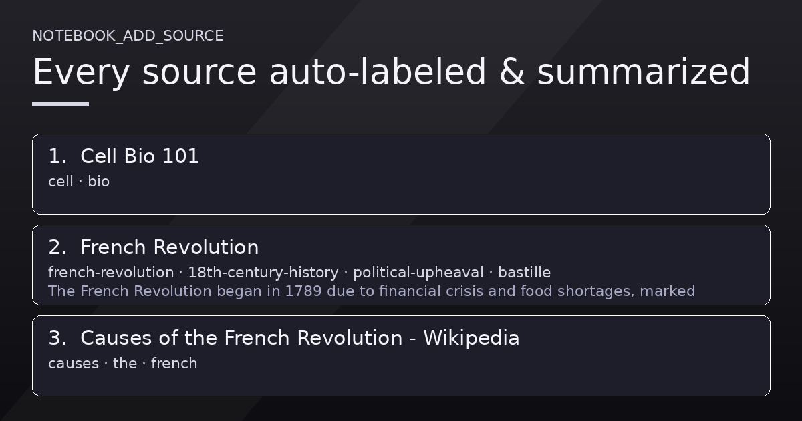
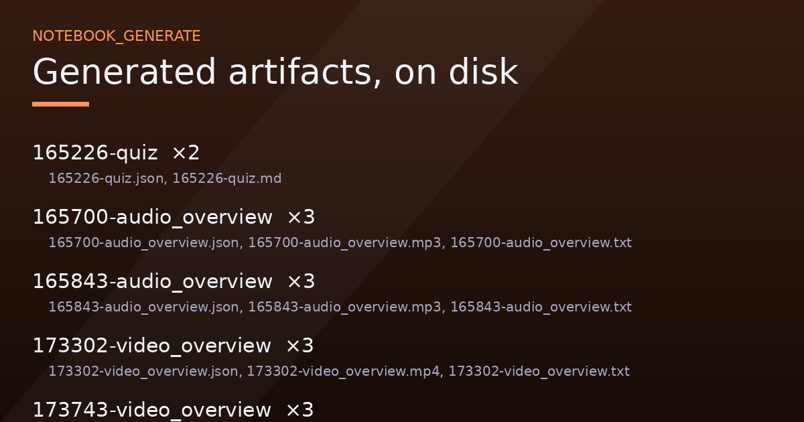

# Hermes Notebook


NotebookLM-style notebooks for [Hermes Agent](https://github.com/NousResearch/hermes-agent): gather sources, ask questions answered **only** from those sources with citations, auto-label everything, generate study artifacts — including mind maps — and produce **audio and video overviews**.

Built for the 2026 Hermes Plugin Competition.

## See it in action








## What it does

| NotebookLM feature | Hermes Notebook |
|---|---|
| Sources (files, PDFs, Office docs, web, YouTube) | `notebook_add_source` — path / URL / pasted text / images (vision-described) |
| Chat with sources + citations | `notebook_ask` — BM25 retrieval, `[S1]`-style citations, optional `thread=` chat history |
| Auto-labeling / source chips | Every source gets 2–5 topic labels + a one-line summary on ingest; duplicates detected by content hash |
| Source search | `notebook_search` — ranked full-text hits with snippets across all sources and notes |
| User notes | `notebook_note` — your annotations become first-class searchable sources |
| Source lifecycle | `notebook_refresh` re-fetches url/file sources, `notebook_delete_source` removes one |
| Suggestions | `notebook_suggest` — questions worth asking, artifacts worth making, source gaps (optional `kinds` filter) |
| Artifacts | `notebook_generate` — summary, briefing doc, study guide, FAQ, timeline, **mind map**, flashcards (md or Anki CSV), quiz, **slide deck** (self-contained HTML), **infographic** (PNG) |
| Audio Overview | `notebook_audio` — two-host conversational podcast (edge-tts voices + ffmpeg), with transcript |
| Video Overview | `notebook_video` — cinematic narrated mp4, `style=cinematic|explainer`, Pillow cards + ffmpeg |
| Web discovery | `notebook_discover` — web_search for candidate sources to add |
| Notebook management | `notebook_update` rename/describe, `notebook_export` whole notebook as zip |
| — Hermes extras — | `/notebook` slash command, `hermes notebook` CLI, bundled skill, auxiliary task slot, per-notebook persistent storage |

## Install

```bash
hermes plugins install DECRUX9812/hermes-plugin-notebook
# or from a local checkout:
hermes plugins install /path/to/hermes-plugin-notebook
```

Requires Python deps declared in `plugin.yaml` (`pypdf`, `edge-tts`, `youtube-transcript-api`, `trafilatura`, `openpyxl`, `pillow`) — installed by the plugin manager. Audio/video overviews additionally need `ffmpeg` on PATH.

## Quickstart

```
/notebook new Q3 Earnings Analysis
/notebook add q3-earnings-analysis ~/Downloads/earnings.pdf
/notebook add q3-earnings-analysis https://example.com/analyst-note
/notebook ask q3-earnings-analysis what drove the margin expansion?
```

Or just ask in chat: *"create a notebook called X and add these files, then make a study guide and a podcast about it"* — the bundled `notebook` skill teaches the agent the workflow.

CLI equivalents: `hermes notebook list|new|add|ask|generate|audio|video|suggest|search|note|update|rm-source|export|discover|delete`.

## Tools

- `notebook_list` — notebooks, or sources inside one (`include_text` for full text)
- `notebook_create` — new notebook
- `notebook_add_source` — one source per call (`path` | `url` | `text`, plus optional `title`); skips exact duplicates
- `notebook_ask` — grounded Q&A with citations; optional `source_ids` scope and `thread=` follow-up history
- `notebook_search` — ranked snippet search across the notebook
- `notebook_note` — save a user note as a searchable source
- `notebook_refresh` — re-fetch a url/file source in place (re-labels + re-summarizes)
- `notebook_delete_source` — remove one source and its stored text
- `notebook_generate` — artifacts to `<notebook>/artifacts/`; `format=csv` for Anki-importable flashcards
- `notebook_audio` — mp3 + transcript + script JSON
- `notebook_video` — mp4 + transcript + script JSON; `style=cinematic|explainer`
- `notebook_suggest` — next-step recommendations; optional `kinds` filter
- `notebook_update` — rename a notebook / change its description
- `notebook_export` — zip the notebook (sources, index, artifacts, chat) under `plugin-data/exports/`
- `notebook_discover` — web_search candidate sources for a topic (does not add them)
- `notebook_delete` — destructive, requires `confirm=true`

## Configuration

Under `plugins.entries.hermes-notebook.settings` (or `hermes plugins config`):

| key | default | meaning |
|---|---|---|
| `default_notebook` | `""` | notebook used when a call doesn't name one |
| `ask_context_chars` | `28000` | context budget per `notebook_ask` |
| `podcast_context_chars` | `42000` | context budget for scripts/artifacts |
| `podcast_length` | `medium` | default audio length (short ≈5m, medium ≈10m, long ≈18m) |
| `video_length` | `medium` | default video length (short ≈2m, medium ≈4m, long ≈7m) |
| `video_voice` / `video_voice_rate` | `en-US-AndrewNeural` / `-4%` | narrator voice + pace for videos |
| `audio_tts_concurrency` | `4` | parallel TTS segment workers |
| `audio_voice_host_a` / `audio_voice_host_b` | `en-US-AndrewNeural` / `en-US-EmmaNeural` | edge-tts voice names |

Cheap calls (source labeling, suggestions) route through the plugin's own `auxiliary.notebook` task slot — pin a model there if you want labels on a smaller/faster model.

## Storage

All state lives under `<hermes home>/plugin-data/hermes-notebook/notebooks/<id>/` — per-profile, survives plugin updates:

```
notebook.json          metadata (title, description, updated_at)
threads/<name>.json    chat history per ask-thread
sources/index.json     source records (id, title, kind [incl. "note"], labels, summary, hash, locator)
sources/<id>.txt       extracted text
artifacts/             generated .md / .html / .png / .csv / .json / .mp3 / .mp4 / .txt
../exports/            notebook_export zips
```

## Development

```bash
python -m pytest tests/ -q          # unit tests (no Hermes host needed)
hermes plugins validate .           # manifest + registration checks
hermes plugins doctor               # discovery smoke check
```

Layout: `hermes_notebook/` — `runtime` (ctx glue), `store` (JSON persistence), `extract` (file/HTML → text), `ingest` (sources + auto-labeling + refresh/dedupe), `retrieve` (BM25 chunk retrieval + search), `llmio` (ctx.llm wrappers), `artifacts`, `audio`, `video`, `schemas`, `tools`. `__init__.py` registers tools, `/notebook`, `hermes notebook`, the skill, and the aux task.

## License

MIT
