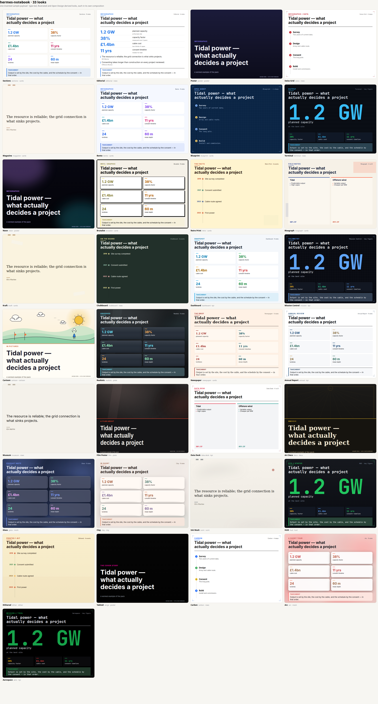
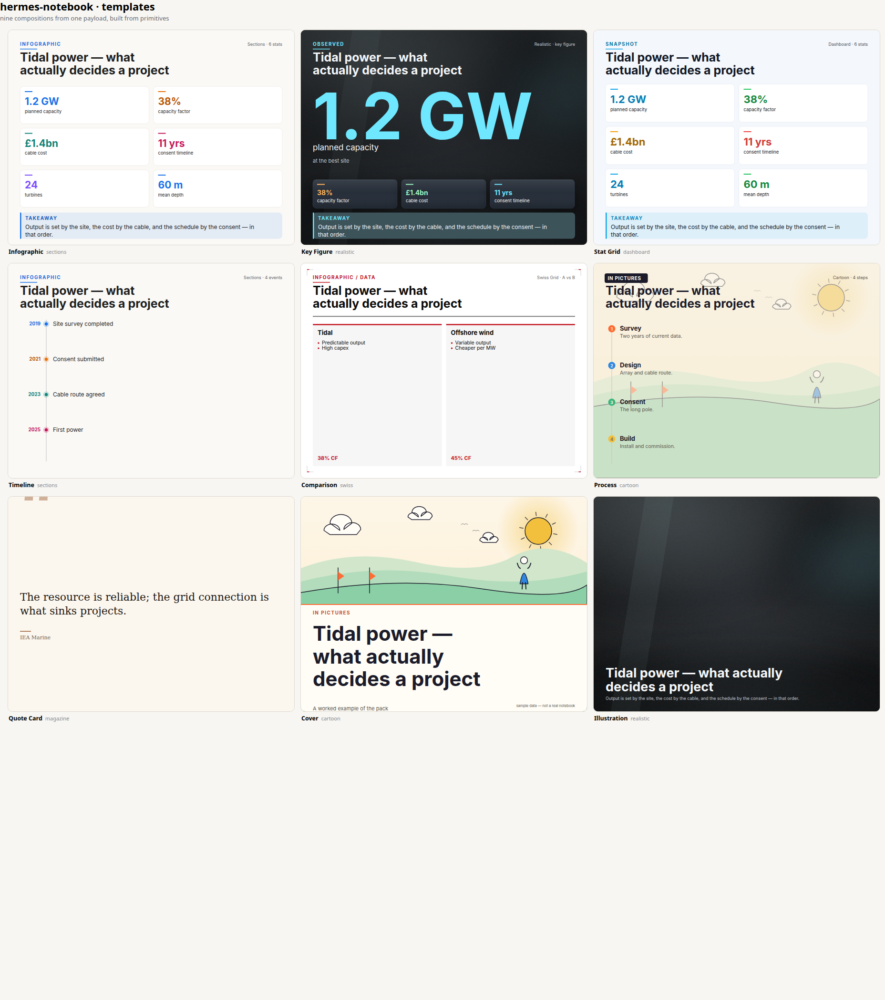

# The graphics library

`hermes_notebook/gfx` is a reusable HTML/SVG graphics library: **33 looks × 9
templates × 3 shapes × 3 detail levels**, composed from primitives instead of
hand-built one-offs. It renders NotebookLM-class artifact visuals without an image
model, so every numeral on the sheet is the numeral that came out of the sources.





---

## 1. How NotebookLM does it, and what that means for us

One targeted search (Google's own NotebookLM help pages, plus a client library that
mirrors the feature surface) establishes the shape of the reference product:

| NotebookLM behaviour | What it implies |
|---|---|
| Studio → **Infographic**; the visual is generated **in the background** while you keep working | generation is asynchronous and model-bound, not instant |
| Customisation panel: **output language**, **level of detail** (Concise / Standard / Detailed), **orientation** (Square / Portrait / Landscape), **visual style** presets (Sketch Note, Kawaii, Professional, …), plus a **free-text prompt** | the product is a *style space*, not one poster: presets + knobs + an escape hatch |
| Auto-select if you don't choose | defaults matter more than the picker |
| Download as **PNG**; stored as an artifact with rename/share/delete | a raster download is the delivery format, but the artifact is the object |
| Styles are described as looks (Sketch Note, Kawaii) rather than layouts | the model paints; typography and numbers are *not* guaranteed to be exact |
| It is credited mainly with composition and "fun, engaging" summaries | the bar is visual interest, not data fidelity |

Two conclusions drive this library:

1. **Match the controls.** Users expect language, detail, orientation and a style
   choice. We ship detail (`concise|standard|detailed`), orientation
   (`landscape|portrait|square`), a named look (18), and a layout
   (9) — the same knobs, discoverable without a prompt.
2. **Beat it where it is weak.** A painted poster can mis-set a number, cannot be
   restyled without regenerating, is not searchable, not screen-reader friendly and
   not themed by the host app. A vector library is exact, instant, restyleable,
   accessible, themeable and a few kilobytes — and can still be rasterised to PNG
   for sharing.

We deliberately do **not** try to paint. Illustration is expressed as a *treatment*
(`cartoon`, `realistic`) built from primitives, and the painted image-model path
stays available as a separate tool (`baoyu-infographic` + `image_generate`) with
its own verification rule.

### Where each approach wins

| | NotebookLM (image model) | this library (vector) |
|---|---|---|
| Visual invention | high — any art direction from a sentence | bounded by the preset/primitive set |
| Text and number fidelity | not guaranteed | exact — the SVG carries the strings |
| Restyle after the fact | regenerate | change one argument |
| Speed | tens of seconds, background job | ~10–60 ms, synchronous |
| Weight | ~1–3 MB PNG | 5–15 KB SVG |
| Accessibility | an image | `<title>`/`<desc>`, real text nodes |
| Theming by host app | no | `theme={"paper": …, "accent": …}` |
| Editable downstream | no | yes — it is SVG |

---

## 2. Architecture

```
graphic dict ──► normalise_graphic ──► template(frame, preset, graphic)
                        │                        │
                        │                        ├── header / tiles / facts / takeaway
                        │                        └── primitives (core) + art (illustrate)
                        ▼                        ▼
                  presets (themes)  ────►  document.render ──►  SVG  ──►  write / data URL
                                                                  │
                                                                  └──► to_png (Chrome)
                                                                       to_png_pillow (fallback)
```

| module | responsibility |
|---|---|
| `gfx/core.py` | colour math (WCAG contrast, `readable()`), measured text (wrap/fit/clip), SVG primitives, pattern/filter builders |
| `gfx/themes.py` | `Preset` records: palette, typeface, family, art treatment, decoration list; aliases; catalog |
| `gfx/illustrate.py` | the two treatments — `cartoon` (flat fills, outlines, sky/hills/figures) and `plate` (key light, rim light, horizon, grain, vignette) |
| `gfx/templates.py` | nine compositions; measured layout; per-family geometry |
| `gfx/document.py` | orientation, defs assembly, background/scrim, accessibility, serialisation, rasterisation, `library_manifest()` |
| `gfx/__init__.py` | the public API |

Three invariants keep it composable:

1. **A preset is data.** Templates never branch on a preset id; they read `family`,
   `art`, `radius`, `decor`, palette. Adding a look is a record.
2. **Measure before you place.** The closing band is measured first, then the
   secondary block, then the primary grid gets the remainder with a floor height;
   inside a tile the numeral shrinks until value + label (+ detail) fit. Nothing is
   positioned into space that was not measured.
3. **Legibility beats palette fidelity.** `core.readable()` pushes accent ink away
   from its background until numerals clear 4.5:1; the bright accent survives on
   rules, bars and swatches. Chrome never fabricates: bars only when every value is
   a number in the same unit.

---

## 3. API

```python
from hermes_notebook import gfx

svg  = gfx.render(graphic, template="infographic", preset="blueprint",
                  orientation="landscape", detail="standard")
html = gfx.render_html(graphic, preset="cartoon", template="cover")
url  = gfx.data_url(graphic, preset="neon")            # data:image/svg+xml;base64,…
gfx.write_svg("poster.svg", graphic, preset="realistic", template="cover")
gfx.to_png(graphic, "poster.png", preset="realistic", scale=2)   # Chrome
gfx.to_png_pillow(graphic, "poster.png")                          # no browser needed
```

### `render(graphic, template, preset, ...) -> str`

| argument | values | notes |
|---|---|---|
| `graphic` | dict | `title`, `stats[{value,label,detail}]`, `quotes[{text,source}]`, `takeaway`, plus template keys: `events`, `steps`, `left`/`right`, `subtitle`, `source` |
| `template` | `infographic`, `key_figure`, `stat_grid`, `timeline`, `comparison`, `process`, `quote_card`, `cover`, `illustration` | unknown → `infographic` |
| `preset` | any preset id or alias (`swiss`, `cyberpunk`, `photo`, `comic`, …) | unknown → `sections` |
| `orientation` | `landscape` (1200×900), `portrait` (900×1200), `square` (1000×1000), `16:9`, `9:16`, `1:1` | or pass `width=`/`height=` |
| `detail` | `concise` (3 figures/1 fact), `standard` (6/3), `detailed` (8/4) | the drawn count is printed in the corner |
| `theme` | `{"paper": "#0b0b0f", "ink": "#f7f7fa", "accent": "#5eead4", "card": …, "muted": …, "accents": […]}` | recolours a preset to host tokens |
| `responsive` | bool | `viewBox` + `width:100%` instead of fixed pixels |
| `inline` | bool | drop the XML prolog (embedding, data URLs) |
| `desc` | str | override the generated text alternative |

The returned SVG carries `role="img"`, `aria-labelledby` → `<title>` + `<desc>`,
and `data-template` / `data-preset` / `data-detail` for tooling.

### Other entry points

| function | purpose |
|---|---|
| `render_html(graphic, **kw)` | self-contained responsive page: `.stage` card, `<meta viewport>`, light/dark media query, visually-hidden text alternative |
| `write_svg(path, …)` / `write_html(path, …)` | the above, to disk |
| `data_url(graphic, **kw)` | `data:image/svg+xml;base64,…` — 5–15 KB, crisp at any size |
| `to_png(graphic, path, scale=…)` | rasterise via headless Chrome; raises `RuntimeError` when no browser |
| `to_png_pillow(graphic, path)` | raster fallback through the Pillow renderer (`igrender`) — same catalog, no browser |
| `normalise_graphic(anything)` | tolerant payload: clamps lengths/counts, fills placeholders |
| `library_manifest()` | templates, presets, orientations, detail levels, template→preset suggestions |
| `PRESETS`, `TEMPLATES`, `ORIENTATIONS`, `DETAIL_LEVELS`, `Frame` | extension surface |

### Presets

**33 looks**, in three waves. Every look carries its own palette, typeface, radius,
decoration set, art treatment **and default composition** — because 33 looks that all
draw the same card grid are three looks in 33 skins.

| wave | looks | provenance |
|---|---|---|
| 1 · type-led (16) | `sections`, `editorial`, `poster`, `swiss`, `magazine`, `bento`, `blueprint`, `terminal`, `neon`, `brutalist`, `retro`, `risograph`, `kraft`, `chalkboard`, `dashboard`, `mission` | palettes borrowed from Open Design's design systems (`bento`, `editorial`, `wired`, `brutalism`, `mission-control`, …) |
| 2 · editorial + illustrated (2 + 9) | `cartoon`, `realistic`; `newspaper`, `annual`, `museum`, `film`, `data-desk`, `deco`, `glass`, `clay`, `sumi` | the illustrated two are drawn, not photographed; the nine are named design languages (FT salmon, annual report, museum label, film poster, data desk, art deco, mesh glass, claymorphism, sumi-e) |
| 3 · Open Design tokens (6) | `hud`, `dither`, `verge`, `carbon`, `arc`, `aero` | palettes taken from Open Design's `design-tokens.json` for `hud`, `dithered`, `theverge`, `ibm`, `arc`, `spacex` |

Treatments behind them (`Preset.art`):

| art | used by | how it is drawn |
|---|---|---|
| `cartoon` | `cartoon` | picture-book scene: sky wash, sun with glow and rays, three puffy outlined clouds, three overlapping hill bands, flags and a figure; type sits on a plate below, so words never land on the art |
| `plate` | `realistic`, `film` | studio-lit surface: key light upper-left, rim light opposite, a soft light pool instead of a floor seam, vignette and film grain; cards carry a gloss band, a 1px top light and a real cast shadow |
| `mesh` | `glass`, `arc` | three huge blurred colour fields over a gradient — reads as a mesh, never as circles; panels are translucent with a bright top edge |
| `clay` | `clay` | warm matte surface, single soft light, per-card inner highlight and soft bottom shadow |
| `sumi` | `sumi` | two ink-wash strokes (blurred twin under a hard shape) plus a vermilion seal dot |
| `deco` | `deco` | gold double frame, thirteen-ray fan, all strokes |
| `dither` | `dither` | 6px and 10px dot screens plus scan rules — the two-colour print trick for a midtone |
| `hud` | `hud` | 48px reticle grid, corner brackets, header rule, grain |

Default compositions (`Preset.default_template`; `template="auto"` uses it):

| composition | looks |
|---|---|
| `infographic` | sections, editorial, newspaper, clay, arc, realistic |
| `cover` | poster, neon, film, deco, verge, cartoon |
| `key_figure` | terminal, mission, hud, aero |
| `stat_grid` | bento, dashboard, brutalist, annual, glass |
| `quote_card` | magazine, kraft, museum, sumi |
| `process` | swiss, blueprint, carbon |
| `timeline` | retro, chalkboard, dither |
| `comparison` | risograph, data-desk |

Quality rules learned by looking at the output (not by taste):

- **Illustrate with five shapes, not fifteen.** A scene (sky, sun, clouds, hills, figure)
  reads as illustration; the same scene with scattered dots or filler props reads as
  clip art. Extras were removed after review, not added.
- **No hard edges in a "photographic" background.** A floor band with a straight top
  reads as a seam; a soft light pool plus a 10%-opacity horizon line reads as a surface.
- **A dark card needs its own light.** Cards on `realistic` carry a gloss gradient, a
  1px top highlight and a stronger shadow — without them a card is a slightly lighter
  rectangle, and the sheet reads as a dashboard, not a lit sheet.
- **Titles wrap balanced, not greedy.** `core.wrap_balanced` narrows the measure until
  the lines are close to equal, so a headline never leaves one word alone.
- **Figures use tabular numerals** (`tnum`), so columns of numbers line up.
- **A look is also a composition.** Without `default_template`, fifteen styles drew
  the same KPI grid; the sheet read as recolours. `template="auto"` gives each look
  the layout its name promises.
- **The cartoon treatment is a scene, not a diagram.** It does not know the topic; if a
  brief needs the subject drawn (water, turbines, a city), that is the image-model path,
  and the docs say so.

Both are honest constructions: no photographs, no stock imagery — lighting and
shape, drawn. Say so before someone assumes otherwise.

---

## 4. Templates

| template | shape | extra keys |
|---|---|---|
| `infographic` | title, stat tiles (4 families: cards / rows / poster / kpi), key facts, takeaway | — |
| `key_figure` | one dominant number, its label, up to three supporting tiles | `stats[0]` is the hero |
| `stat_grid` | compact tiles only | — |
| `quote_card` | single quote, attribution, oversized quotation mark | `quotes[0]` |
| `timeline` | dated events on a measured spine with rings | `events[{when,what}]` |
| `comparison` | two shaded columns against each other, optional scores | `left`/`right` `{title, score, items[{text}]}` |
| `process` | numbered steps on a rail with connectors | `steps[{title,text}]` |
| `cover` | artwork above, type plate below (title, subtitle, credit) | `subtitle`, `source` |
| `illustration` | the preset's art treatment with a caption | `title`, `takeaway` |

`TEMPLATE_PRESETS` suggests which looks suit which layout, so a caller can ask for a
sensible pairing instead of guessing.

---

## 5. Edge cases and fallbacks

| situation | behaviour |
|---|---|
| graphic is not a dict (`None`, str, list) | normalised to `{}` (a bare string becomes `{"title": …}`) |
| missing `stats`/`quotes` | template draws the rest; each family has a minimum |
| `stats` items are the wrong type | non-dicts skipped; `value`/`label` empty → `—`, row dropped if both empty |
| absurd lengths | title ≤ 180 chars, takeaway ≤ 360, stat label ≤ 90, fact ≤ 220, counts capped (8 figures, 4 facts) |
| unknown preset / template / orientation / detail | falls back to `sections` / `infographic` / `landscape` / `standard` — never raises |
| negative or tiny canvas | clamped to 240 px minimum; huge → 4000 px |
| unsupported fonts | every stack ends in DejaVu (shipped on Linux); measurement uses the wider fallback, so a missing Inter shortens lines rather than overflowing |
| one unbreakable word wider than the box | left intact and clipped with `…` rather than hyphenated invisibly |
| text that could break XML | escaped (`&`, `<`, `>`), verified by test |
| no Chrome for a raster | `to_png` raises with a clear message; `to_png_pillow` draws the same payload with Pillow |
| very small viewport | the SVG is `viewBox`-driven and responsive; type sizes are in canvas units, so a 320 px embed scales proportionally |
| host app theme | `theme=` overrides paper/ink/card/muted/accents and recomputes the tone |

---

## 6. Integration

**In the plugin (this repo).** `notebook_generate(kind="infographic", style=…,
template=…, orientation=…, detail=…)` writes an SVG artifact plus a JSON twin
carrying `_style` and `_graphic`. The Studio card exposes the same knobs
(Look / Layout / Shape / Detail) and previews every look with a live SVG thumbnail
drawn from the notebook's own last infographic.

**Routes.**

```
GET  /api/plugins/hermes-notebook/infographic_styles?previews=1&notebook=<id>
GET  /api/plugins/hermes-notebook/graphics_library
POST /api/plugins/hermes-notebook/generate   {kind:"infographic", style, template,
                                              orientation, detail}
```

**In any other host.** The library has no dependency on Hermes: `from
hermes_notebook import gfx` is enough (Pillow for text metrics, Chrome optional for
rasters). Build a picker from `library_manifest()`, store the SVG string, embed it
inline or as an ``.

**Performance.** A 1200×900 infographic renders in ~15–40 ms and weighs 5–15 KB.
Eighteen SVG previews for the picker total ~155 KB and are cached per (payload,
preset) pair.

---

## 7. Testing

| layer | file | what it holds |
|---|---|---|
| unit | `tests/test_gfx.py` | colour parsing, wrap/clip/fit, payload normalisation and clamps, canvas resolution, alias/fallback resolution, theme overrides, escaping |
| render matrix | `tests/test_gfx.py` | every preset renders valid SVG at the promised canvas with metadata; every template × both house treatments; three orientations; detail changes the tile count |
| accessibility | `tests/test_gfx.py` | `role="img"`, `aria-labelledby` → `<title>`/`<desc>`, description mentions the real figures; contrast ≥ 4.4:1 for every preset's numerals |
| visual regression | `tests/snapshots/gfx.json` | 12 representative renders hashed; a layout change fails the test until snapshots are regenerated deliberately |
| edge cases | `tests/test_gfx.py` | empty payload, one stat, 20 stats, 900-char title, emoji/CJK, 320 px canvas, missing values, determinism, Pillow fallback |

```bash
python3 -m pytest tests/test_gfx.py -q            # unit + render + snapshots
python3 tools/make_graphics_sheet.py --templates --examples
python3 tools/make_graphics_sheet.py --snapshots  # after an intended layout change
```

Visual QA is still manual on purpose: render the sheet, then read one or two tiles
per call at ~600×450. A 16-tile sheet is too small to catch a clipped label.

---

## 8. Limits

- **It typesets, it does not paint.** No photographs, no painterly texture. If the
  ask is "hand-drawn poster", the answer is the image-model path, not this.
- **Nine layouts, not a layout language.** A new composition is a function in
  `templates.py`, not a config file.
- **Text metrics assume DejaVu.** A host with a much wider first-choice font can
  push a line past its box; the layout leaves slack, but exotic fonts are a risk.
- **Rasterisation needs a browser** (or the Pillow fallback, which draws the same
  catalog with slightly different type).
