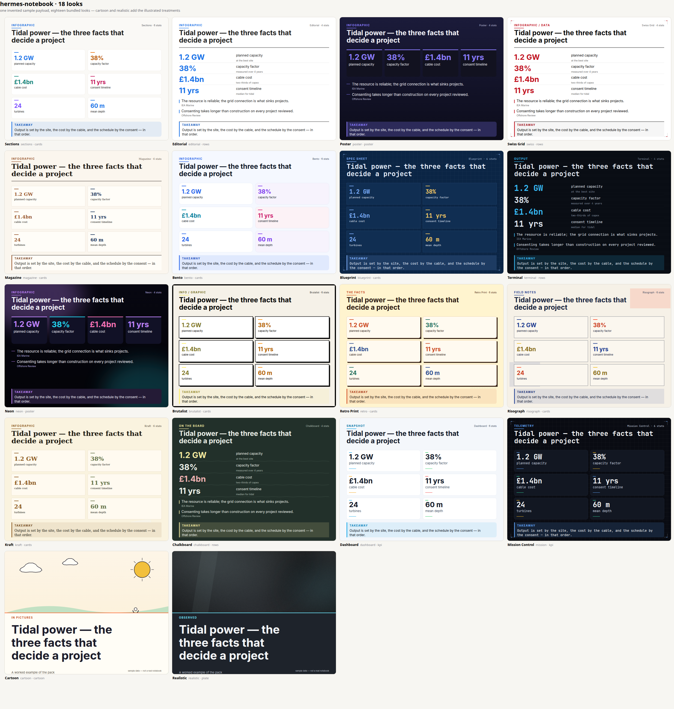

# Infographic styles

> The renderer is now the `gfx` vector library: same catalog, SVG output, plus two
> illustrated treatments and nine layouts. See [`GRAPHICS-LIBRARY.md`](GRAPHICS-LIBRARY.md).

One artifact, sixteen looks. The Infographic card in the studio and
`notebook_generate(kind="infographic")` share a single style pack, so an agent and a person
get the same choices and the same output.



## The design rules

1. **Deterministic, not generated.** PIL draws the PNG. Text is the text — a numeral from
   the sources is never re-typed by a model, so "13,200" cannot come out as "13,000".
2. **A style is data.** `hermes_notebook/igstyles.py` holds one `Style(...)` per look:
   palette, typeface, layout family, corner radius, decorations, tone. The renderer
   (`igrender.py`) branches on those fields only.
3. **Palettes are borrowed.** Every look names the design system it came from in `base`
   (NotebookLM, IBM, Wired, Stripe-family editorial greys, Trading Terminal, Neon, Bento,
   Brutalism, warm-editorial, paper/kraft, dashboard, mission-control). Nothing is invented
   from nothing.
4. **Space is budgeted before it is drawn.** The takeaway band is measured first, the facts
   block second, and the stat tiles get the remainder with a floor height. A six-stat sheet
   with long labels drops a fact row instead of overlapping tiles.
5. **Legibility outranks palette fidelity.** Accent ink is pushed away from the page until
   it clears 4.5:1 for numerals, so a riso yellow survives as a bar accent but never as
   text. Contrast is computed, not eyeballed.
6. **No invented data in the chrome.** KPI bars appear only when every value is a number in
   the same unit; a mixed set of units gets a plain rule instead of a chart that implies a
   scale that does not exist.

## The sixteen

| id | what it is | the palette's origin |
|---|---|---|
| `sections` | **Sections** — Warm paper, white stat cards, one accent per card. <br>_Best for: The default. Any topic, any audience — reads like NotebookLM's own output._ | notebooklm |
| `editorial` | **Editorial** — White page, oversized numerals, hairline rules, one accent. <br>_Best for: Numbers that carry the story: results, milestones, before/after._ | editorial |
| `poster` | **Poster** — Dark indigo gradient, one accent, facts in a strip. <br>_Best for: A launch, an announcement, a single idea that should feel like a cover._ | notebooklm-dark |
| `swiss` | **Swiss Grid** — Helvetica discipline: strict columns, black type, red rule. <br>_Best for: Comparisons, methodology, anything that should look unarguable._ | publication |
| `magazine` | **Magazine** — Warm cream, serif headlines, brown accents, wide margins. <br>_Best for: Culture, history, interviews — long-read material that needs to feel edited._ | warm-editorial |
| `bento` | **Bento** — Mosaic of rounded tiles on cool paper, blue-led accents. <br>_Best for: A roundup: five or six parallel facts that each deserve their own box._ | bento |
| `blueprint` | **Blueprint** — Deep navy grid, white hairlines, monospace labels. <br>_Best for: Engineering, architecture, systems, anything with a spec and a tolerance._ | technical-schematic |
| `terminal` | **Terminal** — Near-black, phosphor blue, monospace, prompt rules. <br>_Best for: Developer tools, incident write-ups, logs and throughput numbers._ | trading-terminal |
| `neon` | **Neon** — Black-violet field with glowing magenta and cyan accents. <br>_Best for: AI, gaming, nightlife, a launch that wants to feel loud and new._ | neon |
| `brutalist` | **Brutalist** — Hard black borders, no radius, acid-yellow highlight. <br>_Best for: Manifestos, takes, pricing pages — content with an attitude._ | brutalism |
| `retro` | **Retro Print** — Cream stock, halftone dots, warm 70s palette. <br>_Best for: History, music, sport, anything with a nostalgic streak._ | retro |
| `risograph` | **Risograph** — Two-ink overprint on cream, deliberately off-register. <br>_Best for: Zines, research roundups, a poster that should look screen-printed._ | riso |
| `kraft` | **Kraft** — Taped paper cards on kraft stock, brown ink, soft serif. <br>_Best for: Field notes, workshops, a handmade brief pinned to a board._ | paper |
| `chalkboard` | **Chalkboard** — Slate green board, chalk white, wobbly hand rules. <br>_Best for: Teaching, a lecture summary, a study poster for a classroom._ | chalkboard |
| `dashboard` | **Dashboard** — Cool grey-white KPI tiles with bar meters and deltas. <br>_Best for: Metrics, benchmarks, a status readout where the numbers are the point._ | dashboard |
| `mission` | **Mission Control** — Dark console: blue, amber and green telemetry tiles. <br>_Best for: Ops, infrastructure, a fleet or a system under load._ | mission-control |

## Families

| family | who uses it | shape |
|---|---|---|
| `cards` | sections, bento, magazine, blueprint, brutalist, retro, risograph, kraft | title block, 1–2 rows of 1–3 stat tiles, key-facts list, takeaway band |
| `rows` | editorial, swiss, terminal, chalkboard | 3–4 full-width rows: oversized numeral, label + detail, hairline rule |
| `poster` | poster, neon | dark gradient, one row of up to four tiles, quotable facts with dashes |
| `kpi` | dashboard, mission | 2–3 column metric grid with optional proportional bars |

## Adding a style

```python
Style(
    "my-look", "My Look", "one line on how it feels", "what content it suits",
    "cards", "base-design-system", paper=(...), ink=(...), muted=(...), card=(...),
    accents=[(...), ...], border=(...), radius=12, typeface="serif",
    decor=("hairline",), tone="light",
)
```

Then `python3 tools/make_style_sheet.py --thumbs` and `python3 -m pytest tests/test_igstyles.py -q`.
The page picker, the tool enum and `GET .../infographic_styles` all read that one list —
there is no second registry to update.

## Surface

| where | what it exposes |
|---|---|
| page | Style picker on the Infographic card (swatch + name grid, 16 entries) |
| tool | `notebook_generate(..., style="<id>")`, enum in the tool schema |
| API | `POST /generate` with `style`, `GET /infographic_styles` for the catalog, `?previews=1&notebook=<id>` for one 240x180 PNG per style (cached per process) |
| artifact | `<stamp>-infographic.png` + a JSON twin carrying `_style` |
| CLI | `hermes notebook generate <nb> infographic --style blueprint` (via the tool) |

## Skills shipped with it

- `skills/notebook-infographics/SKILL.md` — how to choose a look for a given audience, the
  content rules, the illustrated (image-model) fallback, and how to add a style.
- `references/style-pack.md` — every palette and geometry constant.
- `references/generative-prompts.md` — layout × style vocabulary for the painted path,
  condensed from baoyu-infographic (MIT) with attribution.
