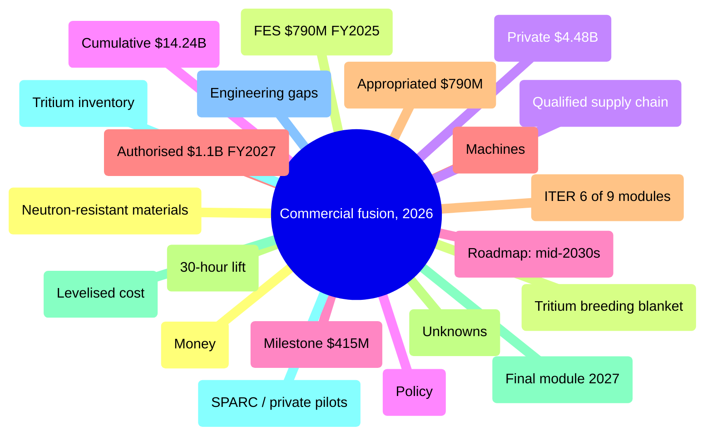

# Commercial Fusion Energy in 2026 — Mind Map

_Generated 20261107-170041 · 6 sources_

---

## Commercial fusion, 2026

- Money — public flat, private record
  - FES $790M FY2025 — 21% to ITER
  - Private $4.48B — 12 months to Jul 2026
  - Cumulative $14.24B — FIA, since 2021
  - Milestone $415M — 8 companies, 2022-27
- Machines — assembly beats physics
  - ITER 6 of 9 modules — two-thirds of torus
  - 30-hour lift — ~1,100 tonnes
  - Final module 2027
  - SPARC / private pilots — compact high-field
- Engineering gaps
  - Neutron-resistant materials
  - Tritium breeding blanket
  - Qualified supply chain
- Policy
  - Roadmap: mid-2030s
  - Authorised $1.1B FY2027
  - Appropriated $790M
- Unknowns
  - Levelised cost — no defensible figure
  - Tritium inventory — kilograms, civil

